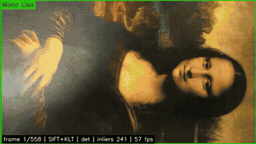
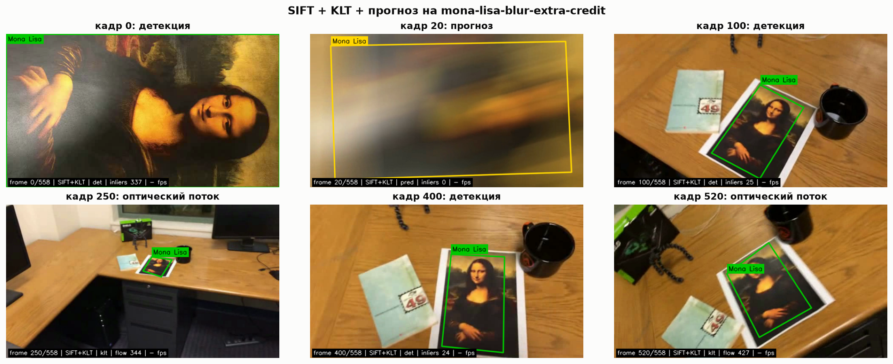
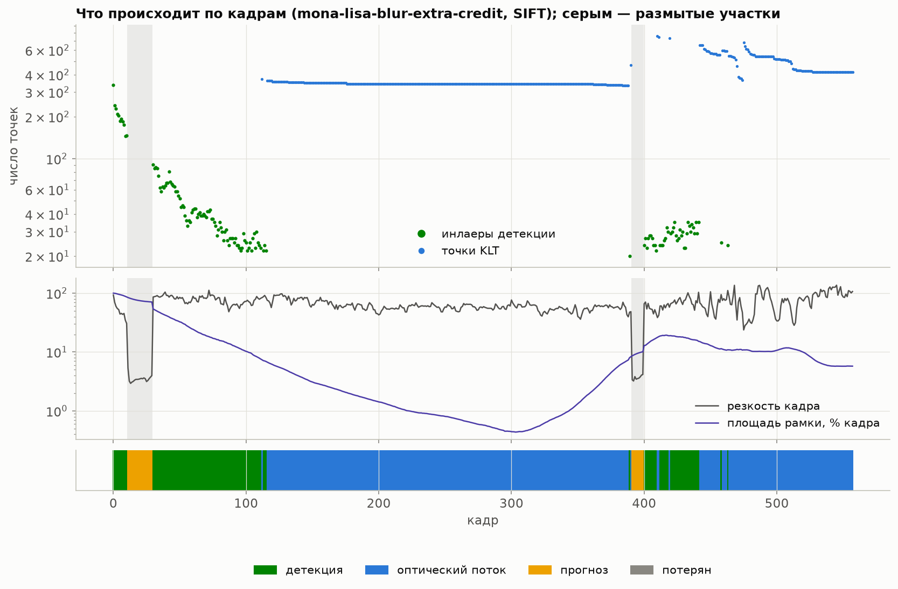
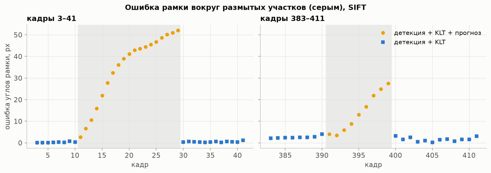
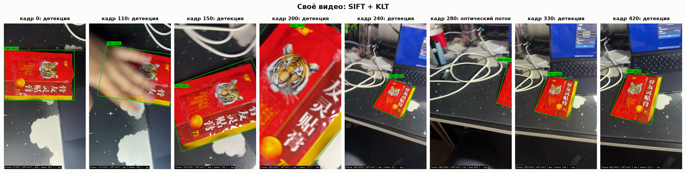
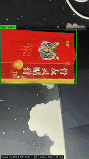
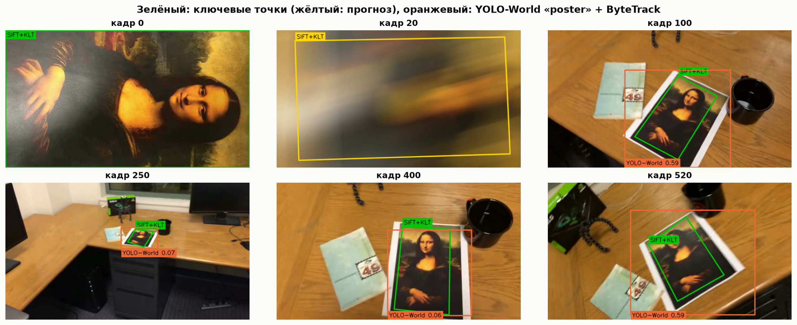

# Трекинг объекта по ключевым точкам

Лабораторная работа №2 по курсу «Системы компьютерной обработки изображений».
Выполнил: Яснов Михаил Андреевич, группа P3417.

Программа берёт объект с первого кадра видео и на каждом следующем кадре обводит его четырёхугольником, который повторяет перспективу. Основа: ключевые точки SIFT, гомография с отбором выбросов (MAGSAC++), а между надёжными детекциями рамку ведёт оптический поток Лукаса–Канаде. Результат: рамка есть на 100 % кадров всех трёх тестовых видео и на своём видео с пачкой пластыря. От рамки в образце преподавателя наша отличается в среднем на 2,9 px. Одна покадровая детекция справилась бы только с 21–31 % кадров: в середине видео картина сжимается до 52×33 px. Дополнительно проверен нейросетевой вариант YOLO-World + ByteTrack: он находит картину на 93–95 % кадров, но рисует прямоугольник по осям вокруг всего листа.



- [Как запустить](#как-запустить)
- [1. Теоретическая база](#1-теоретическая-база)
- [2. Описание разработанной системы](#2-описание-разработанной-системы)
- [3. Результаты работы и тестирования](#3-результаты-работы-и-тестирования)
- [4. Выводы](#4-выводы)
- [5. Использованные источники](#5-использованные-источники)

## Как запустить

```bash
python -m venv .venv && source .venv/bin/activate
pip install -r requirements.txt
python prepare_data.py                     # распаковать ../test-videos.zip в data/
python -m pytest -q                        # 40 тестов

python main.py data/mona-lisa.avi --label "Mona Lisa"            # -> output/mona-lisa_sift.mp4
python main.py data/mona-lisa-blur-extra-credit.avi -d orb --show
python main.py my_video.mp4 --roi select --label "Book"          # своё видео, объект выбрать мышью

python experiments.py                      # таблицы и графики -> results/, около 4 мин
python experiments.py --own data/IMG_3508.MOV --own-roi 0,175,463,331 --own-label "Tiger patch" --own-only

pip install -r requirements-neural.txt     # для YOLO-World
python neural_compare.py                   # около 2 мин на Apple M4
python main.py data/mona-lisa.avi --method yolo --label "Mona Lisa"
python neural_compare.py --own data/IMG_3508.MOV --own-roi 0,175,463,331
```

Своё видео в репозиторий не входит (15 МБ): для повторения положите любой ролик в `data/` и укажите область объекта на первом кадре.

## 1. Теоретическая база

### 1.1. Ключевые точки и дескрипторы

Ключевой точкой (keypoint) называют место изображения, которое можно надёжно найти снова после сдвига, поворота и масштабирования. Например, угол или пятно. Дескриптор описывает окрестность точки вектором, и похожие окрестности дают близкие векторы.

| | SIFT [1] | ORB [2] | AKAZE [3] |
|---|---|---|---|
| Где ищет точки | экстремумы разности гауссиан в пирамиде масштабов | углы FAST в пирамиде изображений | экстремумы в нелинейном масштабном пространстве |
| Дескриптор | 128 чисел, гистограммы градиентов | 256 бит, сравнения яркостей (BRIEF) | 486 бит, M-LDB |
| Расстояние | евклидово (L2) | Хэмминга | Хэмминга |

SIFT самый точный и устойчивый к масштабу, ORB самый быстрый, AKAZE сохраняет края лучше гауссовой пирамиды.

### 1.2. Сопоставление и тест Лоу

Для каждого дескриптора кадра ищутся два ближайших дескриптора эталона. Пара принимается, только если первый сосед заметно ближе второго: $d_1 < 0{,}75\, d_2$ [1]. Так отсекаются точки, похожие сразу на несколько мест эталона. Дальше мы оставляем пары один к одному: каждую точку эталона может занять только одна точка кадра. Это важно. На размытом кадре без такого правила десятки точек эталона сходятся в одну точку кадра, RANSAC считает их инлаерами, и гомография получается вырожденной.

### 1.3. Гомография и RANSAC

Плоский объект при любом положении камеры переходит в кадр проективным преобразованием, гомографией: матрицей $H$ размером 3×3 с восемью степенями свободы [10]. Её можно найти по четырём парам точек:

```math
\begin{pmatrix} x' \\ y' \\ 1 \end{pmatrix} \sim H \begin{pmatrix} x \\ y \\ 1 \end{pmatrix}, \qquad N = \frac{\log(1 - p)}{\log(1 - w^4)}.
```

Среди сопоставлений всегда есть ошибочные, поэтому $H$ ищется методом RANSAC [4]: случайные четвёрки пар дают гипотезы, побеждает та, с которой согласно больше всего пар (инлаеров). При доле правильных пар $w$ и нужной вероятности успеха $p$ хватает $N$ итераций по формуле выше. Мы используем MAGSAC++ [5] (`cv2.USAC_MAGSAC`): он не требует точного порога ошибки. Углы эталона, пропущенные через $H$, дают четырёхугольник рамки.

### 1.4. Оптический поток

Метод Лукаса–Канаде [6] предполагает, что яркость точки между соседними кадрами не меняется, а сдвиг мал, и находит сдвиг в окне вокруг точки из системы 2×2. Пирамидальная версия [7] справляется и со сдвигами в десятки пикселей. Точки для отслеживания выбираются критерием Ши–Томаси [8]: это углы, у которых обе собственные величины матрицы градиентов велики. Ошибочно отслеженные точки отсеиваются проверкой вперёд-назад [9]: точку прослеживают в следующий кадр и обратно, и если она не вернулась на место (ошибка больше 1 px), её выбрасывают. По оставшимся точкам находится гомография между соседними кадрами $H_{\text{шаг}}$, и поза объекта обновляется как $H_t = H_{\text{шаг}} H_{t-1}$. Ошибки при этом накапливаются, поэтому при каждой надёжной детекции поза берётся заново от эталона.

### 1.5. Почему размытие ломает ключевые точки

Размытие стирает высокие частоты, на которых держатся и экстремумы разности гауссиан, и углы. Резкость кадра удобно мерить дисперсией лапласиана: на размытых кадрах тестовых видео она 2,9–5,4, на обычных 24–145. На таких кадрах не работают ни детекция, ни оптический поток, и остаётся только экстраполировать движение рамки.

### 1.6. YOLO-World и ByteTrack

YOLO-World [11] устроен как детектор YOLOv8, у которого классы заданы не номерами, а текстом: подсказка проходит через текстовый кодировщик CLIP, и детектор ищет области, похожие на неё. Так можно искать объект, которого не было среди классов обучения. ByteTrack [12] связывает детекции соседних кадров в треки по пересечению рамок с прогнозом фильтра Калмана. Его особенность в том, что неуверенные детекции он не выбрасывает, а использует на втором шаге сопоставления. Оба метода дают прямоугольник по осям кадра, а не четырёхугольник.

## 2. Описание разработанной системы

### 2.1. Архитектура

```
lab2/
├── tracker/
│   ├── features.py     детекторы SIFT, ORB, AKAZE и сопоставление
│   ├── geometry.py     проекция углов, проверка четырёхугольника, IoU
│   ├── flow.py         точки Ши–Томаси и оптический поток с проверкой вперёд-назад
│   ├── planar.py       PlanarTracker: детекция + поток + прогноз
│   ├── draw.py         рамка, подпись, строка состояния
│   └── video.py        чтение кадров и запись mp4 через ffmpeg
├── neural/             YOLO-World + ByteTrack (yolo_world.py, bytetrack_lowconf.yaml)
├── main.py             консольная программа
├── experiments.py      прогоны на тестовых видео -> results/
├── neural_compare.py   сравнение с YOLO-World -> results/
├── prepare_data.py, plot_style.py, tests/
└── results/            таблицы, графики, GIF
```

### 2.2. Обработка одного кадра

Эталоном служит весь первый кадр, его углы и задают рамку. Для своего видео можно выделить объект флагом `--roi`. На каждом следующем кадре `PlanarTracker.update` делает следующее:

1. **Детекция.** Ключевые точки кадра сопоставляются с эталоном (тест Лоу и один к одному), MAGSAC++ даёт гомографию. Она принимается, если инлаеров не меньше 20, их доля не меньше 25 % и рамка проходит проверку геометрии.
2. **Оптический поток.** Если на прошлом кадре объект был найден, до 800 точек Ши–Томаси внутри рамки (в среднем около 390) прослеживаются в текущий кадр и дают вторую оценку гомографии.
3. **Выбор.** Сильная детекция (не меньше 40 инлаеров и доля не меньше 50 %) принимается всегда и сбрасывает накопленную ошибку потока. Слабая детекция принимается, только если отличается от оценки потока не больше чем на max(15 px, 5 % от корня из площади рамки). Иначе берётся оценка потока.
4. **Прогноз.** Если не сработало ни то, ни другое, углы рамки продолжают двигаться с последней скоростью, которая затухает в 0,9 раза за кадр. Так можно продержаться не больше 30 кадров. Дальше объект считается потерянным, и рамка не рисуется.

Проверка геометрии отбрасывает рамки, которые не могут быть изображением плоского прямоугольника: невыпуклые, зеркальные, площадью меньше 0,2 % кадра, с противоположными сторонами, отличающимися больше чем в 3 раза, и с углами вне 30–150°. Рамка рисуется зелёной, а в режиме прогноза жёлтой.

### 2.3. Консольная программа

| Параметр | Что делает |
|---|---|
| `-d sift\|orb\|akaze` | детектор ключевых точек, по умолчанию SIFT |
| `--no-klt` | только покадровая детекция, без оптического потока |
| `--max-coast N` | сколько кадров рисовать прогноз после потери, по умолчанию 30 |
| `--roi x,y,w,h\|select` | область объекта на первом кадре |
| `--label`, `-o`, `--csv`, `--show` | подпись рамки, выходное видео, покадровый лог, показ во время работы |
| `--method yolo --prompt poster` | YOLO-World + ByteTrack вместо ключевых точек |

Неверные аргументы программа отклоняет одной строкой до обработки. 40 тестов проверяют восстановление известной гомографии на синтетической текстуре (SIFT с точностью до 1,5 px, ORB и AKAZE до 3 px), ведение рамки по последовательности кадров, отказ без ложной рамки на сильно размытом кадре и шуме, прогноз и повторный захват, проверку геометрии и аргументы CLI.

## 3. Результаты работы и тестирования

Стенд: Apple M4, Python 3.13, OpenCV 4.14. Все числа взяты из [`results/summary.md`](results/summary.md) и [`results/neural.md`](results/neural.md).

### 3.1. Тестовые видео и образец

| Видео | Кадров | Чем отличается от mona-lisa.avi |
|:---|---:|:---|
| mona-lisa | 558 | исходник, 640×360 |
| mona-lisa-blur | 558 | размыты кадры 10–28 |
| mona-lisa-blur-extra-credit | 558 | размыты кадры 11–29 и 391–399, всё видео темнее на 1,8 уровня |

Образец `simple_track.avi` оказался результатом трекера преподавателя на видео extra-credit со сдвигом на один кадр. Это дало внешнюю проверку. Медианное расстояние от зелёной рамки образца до нашей рамки 2,87 px, 95-й перцентиль 5,73 px. Рамка есть у обоих на 526 кадрах, только у образца ни на одном, только у нас на трёх.

### 3.2. Основной результат: SIFT + оптический поток + прогноз

Точного положения картины на кадрах никто не размечал, поэтому эталоном служит наш же трекер SIFT + поток на резком `mona-lisa.avi`. Размытые видео совпадают с ним везде, кроме размытых кадров, так что ошибку на них можно мерить честно.

| Видео | Рамка, % кадров | Из них детекцией, % | Ошибка углов, медиана px | p95, px | Ошибка прогноза на размытых, медиана px | Ложных рамок | Повторный захват, кадров | Кадров/с |
|:---|---:|---:|---:|---:|---:|---:|---:|---:|
| mona-lisa | 100 | 30.8 | эталон | эталон | - | 0 | - | 62 |
| mona-lisa-blur | 100 | 27.4 | 0.00 | 0.00 | 43.3 | 0 | 1 | 61 |
| mona-lisa-blur-extra-credit | 100 | 24.7 | 0.98 | 4.36 | 27.6 | 0 | 1 и 1 | 45 |



Детекция работает, пока картина крупная. С кадра 117 по 389 она сжимается до 0,43 % кадра (52×33 px на кадре 303), SIFT находит меньше 20 инлаеров, и рамку ведёт оптический поток примерно по 390 точкам. На таком длинном участке поток понемногу накапливает ошибку: расхождение с образцом преподавателя растёт с 2,7 px в начале участка до 7,6 px в конце. На кадре 389 детекция снова срабатывает, и поза берётся заново от эталона.



### 3.3. Размытые кадры

На размытых кадрах точки не находит никто, и рамка-прогноз постепенно уплывает: до 52 px к концу первого размытого участка. Ложных рамок нет ни одной. Объект снова находится на первом же резком кадре, и ошибка сразу падает до 1–3 px. Без прогноза (`--max-coast 0`) рамка на размытых кадрах просто не рисуется, так же поступает и образец преподавателя.



### 3.4. Детекторы и вклад оптического потока

Видео mona-lisa-blur-extra-credit:

| Детектор | Вариант | Рамка на резких кадрах, % | Ошибка, медиана px | p95, px | Ложных рамок | Кадров/с |
|:---|:---|---:|---:|---:|---:|---:|
| SIFT | только детекция | 26.0 | 0.83 | 2.62 | 0 | 57 |
| SIFT | + поток | 100 | 0.98 | 4.36 | 0 | 47 |
| ORB | только детекция | 23.4 | 2.35 | 8.34 | 1 | 229 |
| ORB | + поток | 100 | 1.81 | 6.72 | 0 | 128 |
| AKAZE | только детекция | 21.7 | 2.73 | 10.65 | 1 | 74 |
| AKAZE | + поток | 100 | 1.57 | 10.67 | 2 | 54 |

Без оптического потока все три детектора теряют картину на трёх четвертях кадров, с потоком ведут её всегда. SIFT точнее всех, ORB в 2,7 раза быстрее при ошибке около 2 px, у AKAZE самый большой хвост ошибок и две ложные рамки. Важная оговорка: эталон построен на SIFT, поэтому сравнение немного в его пользу.

### 3.5. Своё видео

Ролик снят на iPhone вертикально: 430 кадров, 14 с, пачка пластыря с тигром на столе. Он проверяет то, чего нет в тестовых видео: перекрытие рукой, поворот, наезд вплотную, когда пачка не помещается в кадр, отдаление с размытием и частичный выход за край кадра. Кадры обрабатывались в разрешении 540×960. Пачка на первом кадре занимает только его верхнюю часть, поэтому эталоном служит её прямоугольник `--roi 0,175,463,331`, найденный по красному и жёлтому цвету.

| Рамка, % кадров | Детекция, % | Оптический поток, % | Прогноз, % | Потерян, % | Кадров/с |
|---:|---:|---:|---:|---:|---:|
| 100 | 77.9 | 22.1 | 0 | 0 | 36 |

Когда в кадр входит рука (кадры 105–107), три кадра рамку ведёт поток, а дальше SIFT находит пачку под рукой по 45–239 инлаерам. Оптический поток понадобился на отдалении и там, где пачка наполовину вышла из кадра (кадры 260–298), а прогноз не понадобился ни разу. Разметки здесь нет, поэтому точность проверялась глазами по всему ролику: рамка лежит по краям пачки.





### 3.6. Дополнительно: YOLO-World + ByteTrack

Подсказка для YOLO-World подбиралась на каждом пятом кадре `mona-lisa.avi`:

| Подсказка | Рамка с IoU ≥ 0,5 с картиной, % кадров |
|:---|---:|
| poster | 96.4 |
| picture frame | 93.8 |
| painting | 76.8 |
| portrait painting | 73.2 |
| Mona Lisa | 20.5 |

Трекинг с подсказкой «poster»:

| Видео | Рамка, % кадров | IoU ≥ 0,5, % кадров | На размытых, % | Средний IoU | Смен трека | Кадров/с (MPS) |
|:---|---:|---:|---:|---:|---:|---:|
| mona-lisa | 95.2 | 87.6 | - | 0.60 | 4 | 56 |
| mona-lisa-blur | 94.4 | 86.9 | 0 | 0.60 | 4 | 55 |
| mona-lisa-blur-extra-credit | 92.7 | 84.6 | 0 | 0.59 | 3 | 48 |



Сначала ByteTrack держал картину только на 51 % кадров, хотя сам YOLO-World находил её на 85 %. Причина оказалась в параметре `fuse_score`, включённом по умолчанию: он умножает IoU на уверенность детекции, а у YOLO-World для маленькой картины уверенность 0,03–0,17, и трек не подтверждался. После его отключения и снижения порогов доля выросла до 95 %. На своём видео лучшей оказалась подсказка «red package»: рамка на 85,8 % кадров, совпадение с рамкой ключевых точек по IoU ≥ 0,5 на 85,1 %, средний IoU 0,91. Подсказка «poster» дала 80 %, «packet» не нашла пачку ни разу. Пачка почти прямоугольная и без белых полей, поэтому прямоугольник YOLO совпадает с ней лучше, чем с картиной ([`results/neural_own.md`](results/neural_own.md)).

Слабые стороны нейросетевого варианта хорошо видны на рисунке: прямоугольник по осям обводит весь лист с белыми полями, перспективы нет, на размытых кадрах и на первом крупном плане картина не находится. По скорости YOLO-World на графическом ядре M4 такой же, как SIFT с потоком на процессоре, но требует 25 МБ весов и разовой загрузки CLIP на 354 МБ.

## 4. Выводы

1. Трекер на ключевых точках SIFT, гомографии MAGSAC++ и оптическом потоке ведёт объект на 100 % кадров всех трёх тестовых видео и своего видео, где пачку перекрывает рука и она выходит за край кадра. От образца преподавателя рамка отличается в среднем на 2,9 px, на самом длинном участке без детекции расхождение дорастает до 7,6 px.
2. Одна покадровая детекция недостаточна: когда объект сжимается до 52×33 px, любой из трёх детекторов теряет его, и находит картину только на 21–31 % кадров. Оптический поток закрывает эти кадры, а детекция по мере возможности сбрасывает его накопленную ошибку.
3. На сильно размытых кадрах ключевых точек нет совсем. Защита от вырожденных гомографий (пары один к одному и проверка геометрии) убирает ложные рамки, прогноз даёт приблизительную рамку с ошибкой до 52 px, а повторный захват происходит на первом резком кадре.
4. SIFT точнее ORB и AKAZE, ORB в 2,7 раза быстрее. Для этой задачи хватает SIFT: 45–62 кадра в секунду на процессоре.
5. YOLO-World + ByteTrack находит объект по текстовой подсказке без эталона, но даёт только прямоугольник вокруг всего листа и требует настройки трекера под неуверенные детекции. Для точной рамки плоского объекта ключевые точки подходят лучше.

## 5. Использованные источники

1. Lowe D. G. Distinctive Image Features from Scale-Invariant Keypoints // International Journal of Computer Vision. — 2004. — Vol. 60, No. 2. — P. 91–110. — DOI: [10.1023/B:VISI.0000029664.99615.94](https://doi.org/10.1023/B:VISI.0000029664.99615.94).
2. Rublee E., Rabaud V., Konolige K., Bradski G. ORB: An efficient alternative to SIFT or SURF // 2011 International Conference on Computer Vision. — 2011. — P. 2564–2571. — DOI: [10.1109/ICCV.2011.6126544](https://doi.org/10.1109/ICCV.2011.6126544).
3. Alcantarilla P. F., Nuevo J., Bartoli A. Fast Explicit Diffusion for Accelerated Features in Nonlinear Scale Spaces // Proceedings of the British Machine Vision Conference. — 2013. — P. 13.1–13.11. — DOI: [10.5244/C.27.13](https://doi.org/10.5244/C.27.13).
4. Fischler M. A., Bolles R. C. Random Sample Consensus: A Paradigm for Model Fitting with Applications to Image Analysis and Automated Cartography // Communications of the ACM. — 1981. — Vol. 24, No. 6. — P. 381–395. — DOI: [10.1145/358669.358692](https://doi.org/10.1145/358669.358692).
5. Barath D., Noskova J., Ivashechkin M., Matas J. MAGSAC++, a Fast, Reliable and Accurate Robust Estimator // 2020 IEEE/CVF Conference on Computer Vision and Pattern Recognition. — 2020. — P. 1301–1309. — DOI: [10.1109/CVPR42600.2020.00138](https://doi.org/10.1109/CVPR42600.2020.00138).
6. Lucas B. D., Kanade T. An Iterative Image Registration Technique with an Application to Stereo Vision // Proceedings of the 7th International Joint Conference on Artificial Intelligence. — 1981. — P. 674–679.
7. Bouguet J.-Y. Pyramidal Implementation of the Lucas Kanade Feature Tracker: Description of the Algorithm. — Intel Corporation, Microprocessor Research Labs, 2000.
8. Shi J., Tomasi C. Good Features to Track // Proceedings of IEEE Conference on Computer Vision and Pattern Recognition. — 1994. — P. 593–600. — DOI: [10.1109/CVPR.1994.323794](https://doi.org/10.1109/CVPR.1994.323794).
9. Kalal Z., Mikolajczyk K., Matas J. Forward-Backward Error: Automatic Detection of Tracking Failures // 2010 20th International Conference on Pattern Recognition. — 2010. — P. 2756–2759. — DOI: [10.1109/ICPR.2010.675](https://doi.org/10.1109/ICPR.2010.675).
10. Hartley R., Zisserman A. Multiple View Geometry in Computer Vision. — 2nd ed. — Cambridge University Press, 2004. — 655 p. — ISBN 978-0-521-54051-3.
11. Cheng T., Song L., Ge Y., Liu W., Wang X., Shan Y. YOLO-World: Real-Time Open-Vocabulary Object Detection // 2024 IEEE/CVF Conference on Computer Vision and Pattern Recognition. — 2024. — P. 16901–16911. — DOI: [10.1109/CVPR52733.2024.01599](https://doi.org/10.1109/CVPR52733.2024.01599).
12. Zhang Y., Sun P., Jiang Y., Yu D., Weng F., Yuan Z., Luo P., Liu W., Wang X. ByteTrack: Multi-Object Tracking by Associating Every Detection Box // Computer Vision – ECCV 2022. Lecture Notes in Computer Science. — Springer, 2022. — P. 1–21. — DOI: [10.1007/978-3-031-20047-2_1](https://doi.org/10.1007/978-3-031-20047-2_1).
13. OpenCV 4.x Documentation. Feature Matching + Homography to find Objects [Электронный ресурс]. — URL: https://docs.opencv.org/4.x/d1/de0/tutorial_py_feature_homography.html (дата обращения: 19.10.2026).
14. Ultralytics Documentation. YOLO-World; Multi-Object Tracking [Электронный ресурс]. — URL: https://docs.ultralytics.com/models/yolo-world/ (дата обращения: 19.10.2026).
